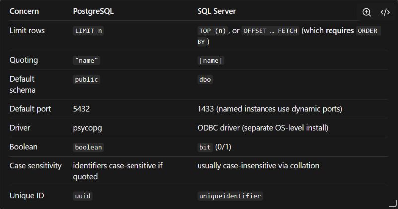

SQL SERVER - VAIBHAV

Every Universal SQL connector, whatever the database, has the same five jobs:
1) **Connect**: build a connection string, authenticate, apply timeouts.
2) **Introspect**: list schemas, tables, views, columns, types, PKs, FKs.
3) **Normalize**: map DB-specific types onto NeuroNova’s own types (text, integer, float, bool, datetime, binary, unsupported).
4) **Read safely**: sample rows and fetch counts without hurting the customer’s database.
5) **Close and clean up**. 

For SQL Server ( I checked about its operation and the above 5 core jobs never change). One thing i came across:

> ***SQL Server can run normally also and as a Data Warehouse also***

 The Two Modes:
 1) **Running Normally(OLTP - Online Transactional Processing):**  The database is driving a live application (like a website or an inventory system). It handles thousands of tiny requests per second—inserting one row, updating one password, deleting one item.
 2) Running as a Data Warehouse (OLAP - Online Analytical Processing):  The database stores historical company data. It doesn't handle live users; instead, it runs massive, heavy queries over billions of rows to generate business reports (e.g., _“Show me our profit margins by zip code over the last ten years”_).


Doubling Down on the five steps i wrote above:

1) **Connect.** Same in both modes. The connector builds a connection string, authenticates (Windows Authentication, or SQL Server Authentication, which requires the server to be in Mixed Mode) and applies two separate timeouts:
    - **Login timeout:** how long to wait for the network handshake and authentication (typically 10-20 s).
    - **Query timeout:** how long one query may run before it’s cancelled (typically 30 s). Never use `0` (infinite) in production, because a hung query would hold a worker forever.
    - A default instance listens on port 1433. A **named instance** (`HOST\SQLEXPRESS`) uses a dynamic port that SQL Browser reports, so the connector must support connecting without a port.
2. **Introspect.** Same in both modes. The connector reads schemas, tables, views, columns, types, primary keys, foreign keys and approximate row counts.
    - _Not implemented yet (future step):_ index introspection, meaning B-tree (rowstore) indexes, mostly in OLTP, and columnstore indexes, mostly in warehouses. This will later help choose sampling and filter strategies.
    - _Out of scope:_ distribution keys. They belong to Azure Synapse and Parallel Data Warehouse, not SQL Server, so they matter only if a Synapse connector is added later.
3. **Normalize.** Same mapping logic in both modes, because the data types are identical. A warehouse just tends to hit the awkward types more often: large `decimal`s, `datetimeoffset`, very wide tables, and placeholder dates like `1900-01-01`.
4. **Read safely.** Same rules, different risk:
    - _OLTP, priority: don’t block live users._ Use short queries and a query timeout, prefer a read replica or snapshot isolation, and keep samples small.
    - _Warehouse, priority: don’t exhaust the server._ Never run `COUNT(*)` on huge tables (read approximate counts from `sys.partitions`), avoid big sorts such as `ORDER BY NEWID()` (they spill into `tempdb`), and always bound row counts.
5. **Close & clean up.** Same in both modes. The connector closes cursors and connections, cancels queries that exceed their timeout, runs in autocommit so no transaction is left open, and never creates temp tables. SQL Server manages `tempdb` itself. The connector doesn’t purge it, it only avoids _causing_ heavy `tempdb` use (see job 4).

***IN MY IMPLEMENTATION - WHAT IS Base.py doing?***

Base.py does not talk to any database. It defines the shape of the data every connector must return and the methods every connector must have
> The rest of NeuroNova (EDA engine, chatbot, frontend) only ever talks to this contract, never to SQL Server, Postgres or Oracle directly.

It has two parts: **data classes** (what comes out) and an **abstract class** (what a connector must do).

### Part 1: Data classes (the common language)

```
@dataclass
class ColumnInfo:
    name: str
    raw_type: str
    normalized_type: str
    nullable: bool
    max_length: int | None = None
    precision: int | None = None
    scale: int | None = None
    is_pk: bool = False
```

Every database describes a column differently. SQL Server says nvarchar, Postgres says character varying, Oracle says VARCHAR2. ColumnInfo is one fixed format that all of them get converted into.

- **`raw_type`** is what the database said, kept for debugging and display (`datetime2`).
- **`normalized_type`** is NeuroNova’s own vocabulary (`datetime`). The profiler only needs to know “this is a date”, not which of SQL Server’s six date types it is. This is the field the rest of the platform actually uses.
- **`nullable`, `max_length`, `precision`, `scale`** are extra metadata. For example, the AI layer can tell that `DECIMAL(10,2)` is probably money.
- **`is_pk`** marks primary key columns.
- The `= None` / `= False` defaults mean a field can be missing. A `bit` column has no max length, and that’s fine.


```
@dataclass
class ForeignKey:
    name: str
    columns: list[str]
    ref_schema: str
    ref_table: str
    ref_columns: list[str]
```

This describes one relationship: “these columns here point to those columns there.” Both sides are **lists** because of composite foreign keys, where two or more columns together form one reference. If you stored a single column name, composite keys would break. Relationships are how NeuroNova understands joins, so this is critical for the “company intelligence” idea on your whiteboard.

```

@dataclass
class TableInfo:
    schema: str
    name: str
    kind: str            # "table" | "view"
    columns: list[ColumnInfo] = field(default_factory=list)
    foreign_keys: list[ForeignKey] = field(default_factory=list)
    approx_rows: int | None = None
```

This is one table or view with everything attached: its columns, its relationships, and roughly how big it is.
- **`schema` + `name`** together identify a table. `sales.orders` and `dbo.orders` are different tables.
- **`kind`** separates tables from views, since views have no PKs or FKs and can be expensive to query.
- **`field(default_factory=list)`** gives each table its own fresh empty list. Writing `= []` directly would make every table share the same list, a classic Python bug that dataclasses explicitly guard against.
- **`approx_rows`** is “approximate” on purpose, because exact counts are too slow on big tables.

So the hierarchy is: `TableInfo` → has many `ColumnInfo` and many `ForeignKey`.

### Part 2: The abstract class (the promise)

```
class SQLConnector(ABC):
    @abstractmethod
    def test_connection(self) -> dict: ...
    @abstractmethod
    def list_tables(self) -> list[TableInfo]: ...
    @abstractmethod
    def sample(self, schema: str, table: str, n: int = 1000) -> list[dict]: ...
    @abstractmethod
    def close(self) -> None: ...
```

`ABC` plus `@abstractmethod` means you **cannot** create a `SQLConnector` directly, and any subclass must implement all four abstract methods. Otherwise Python raises a `TypeError` the moment you try to create it..

If the AI writes `OracleConnector` and forgets `close()`, it fails immediately instead of silently at runtime in production. The four methods are the lifecycle of any connector:

![[Pasted image 20261031235121.png]]

The `...` bodies are intentionally empty. The base class defines _what_, and subclasses define _how_.

In my implementation here is how actually things work:

1. **What is the "Base Class"?**

	The **Base Class** is **`SQLConnector`**.

	- Think of it as the **Boss** or the **Master Template**.
	- It doesn't actually do any real work itself. Instead, it lays down the law and defines the rules. It says: _"To work here, you must know how to test a connection, list tables, take a sample, and close the connection."_

2. What is a "Subclass"?

	A **Subclass** is any specific database connector you build _derived from_ that template (for example: an `OracleConnector`, `PostgresConnector`, or `SqlServerConnector`).
	
	- Think of the subclass as the **Employee** or the **Specialist**.
	- It inherits all the rules from the Base Class, but it is the one that actually writes the gritty code to talk to its specific database.

3. What do the blank dots `...` do?

	In Python, `...` is called an **Ellipsis**, and it literally means **"nothing goes here yet."** It is just a temporary placeholder.

	Because the Base Class (`SQLConnector`) is just a theoretical template, it doesn't know _how_ to talk to Oracle or Postgres. It just knows that a connector _should_ do it.
	
	So, instead of writing real code, the programmer puts `...` to say:

```
"Here is the name of the function we need. The body is blank for now. The subclass (the specialist) will fill in the real code later."		
```

```
"The base class defines what [SQLConnector says: 'We need to close connections!'], and subclasses define how [OracleConnector writes the exact code to disconnect from Oracle, while PostgresConnector writes different code to disconnect from Postgres]."
```


### Why this matters for your plan

1. **The rest of NeuroNova stays database-agnostic.** The profiler takes a `list[TableInfo]` and doesn’t care whether it came from SQL Server or Oracle. Adding a new database means writing one new class, with no changes elsewhere.
2. **It’s your spec for the AI.** “Implement `OracleConnector(SQLConnector)`, returning these exact dataclasses” is a precise instruction with a checkable result. The edge cases you collect become the difference between a connector that returns the right dataclasses and one that returns wrong or crashing ones.
3. **It forces normalization to happen in one place.** The messy per-database work (type mapping, quoting, FK queries) lives inside each connector, and everything downstream gets clean data.

**Where it’s still thin (things you may want to add)**
1) **`dialect` / `capabilities` info**, so the platform knows if a database supports `TABLESAMPLE` or not.

	Dialect / Capabilities Info (Knowing what the DB can do)
	
	**The Problem:** Not all databases are equally smart. For example, some modern databases have a built-in fast track for grabbing samples (called `TABLESAMPLE`). Older or simpler databases don't have this feature and will crash if you try to use it.

	- **The Fix:** You add a checklist inside `base.py` called `capabilities`. Before the app tries to do something complex, it checks this list.
	- **Analogy:** It’s like checking if a smartphone has a fingerprint scanner before forcing the user to log in with their thumb. If the database supports a shortcut, use it; if not, fall back to the slow, safe method.

2) **Typed error classes** like `ConnectorAuthError`, `ConnectorNetworkError`, `ConnectorPermissionError`, so the frontend can say “wrong password” and not just “failed.” Typed Error Classes (Smart Error Messages) **The Problem:** When something goes wrong, the database returns a wall of cryptic driver text. Without structure, the user only sees “Error: Process Failed.” Was the server down? Was the password wrong? Did they lack permission? **The Fix:** Create one base class, `ConnectorError`, and specific subclasses:

- `ConnectorAuthError`: wrong or expired password, disabled login
- `ConnectorNetworkError`: host unreachable, port closed, connection dropped
- `ConnectorTimeoutError`: login or query took too long
- `ConnectorPermissionError`: logged in, but not allowed to see or read something
- `ConnectorConfigError`: missing ODBC driver, untrusted TLS certificate

Don’t name any of them `PermissionError`, because that’s already a Python built-in. **How it works:** Each connector catches the driver’s raw error, reads its **SQLSTATE code** (a standard 5-character error code), and re-raises the matching typed error. The connection string must never appear in any error message, because it contains the password. The original driver error is kept inside the typed error for debugging only. **The Result:** The frontend maps each class to a clear message (“Your password is wrong or expired”, “Can’t reach the server, check host, port and firewall”) instead of a generic crash screen. _Status: implemented in `connectors/errors.py` and `_translate()` in `sqlserver.py`. SQLSTATE mappings still need confirming against a real server (tests A, C, D, F).


3) **Streaming or batching for `sample`**, since returning a giant list of dicts doesn’t scale.
	
   Streaming or Batching for Samples (Handling huge data safely)

	**The Problem:** Your `sample()` method currently asks to return a `list` of rows. If the AI asks for a sample from a massive table and the system tries to pull 50,000 huge rows into Python's memory all at once, the server will run out of RAM and **instantly crash**.

	- **The Fix:** Instead of dumping the whole bucket of data at once, you switch to "streaming" or "batching." You change the code to hand over data in bite-sized chunks (e.g., 100 rows at a time).
	- **Analogy:** Instead of trying to download a whole 2-hour movie before you can watch it (and running out of disk space), you stream it second-by-second.

4) **A context manager** (`__enter__`/`__exit__`) so `close()` is never forgotten.

	A Context Manager (The Automatic Safety Net)

	**The Problem:** Your current template relies on the programmer remembering to call `close()` at the very end. If a developer forgets—or if the program crashes halfway through—the connection stays open forever. Leave too many connections open, and the client's database will freeze up and lock everyone out.

	- **The Fix:** Python has a built-in safety net called a **Context Manager** using the keyword `with` (powered by hidden actions called `__enter__` and `__exit__`).
	- **The Result:** You wrap your database operations in a `with` block. The moment the program finishes reading data (or even if it completely crashes and burns in the middle), Python **automatically forces the connection to close safely** in the background. It removes human error entirely.


![[Pasted image 20261102030359.png]]

### Why this matters for your normalization

My skeleton squashed all six into `"datetime"`, which is simple but loses information in a few places. These are worth knowing as edge cases:

- **`time` has no date.** Treating it as a full datetime makes no sense. You can’t plot a trend over time with `14:30` alone. It’s probably better as its own normalized type, like `"time"`.
- **`date` vs `datetime`** matter for grouping. Daily trends are natural for `date`, while hourly ones suit `datetime`.
- **`datetimeoffset` carries a time zone.** If you flatten it, two values like `10:00 +05:30` and `10:00 +00:00` look equal but are 5.5 hours apart. Decide whether to convert to UTC.
- **Range overflow:** `datetime2` allows year `0001`. Python’s `pandas` can’t represent dates that far back, so such values can crash the profiler.
- **Not a date at all:** SQL Server has a type called `timestamp`, which sounds like a date but is actually a binary row-version counter. That’s why my map puts it under `"binary"`. A name-based guess here would be a trap.

##### **Where SQL Server differs from Postgres**



##### **Edge Cases** **by layer** 

1) At the connection layer
- **ODBC(open database connectivity) driver missing or wrong version**: the most common failure. Driver 18 defaults to `Encrypt=yes`, so servers with self-signed certs fail unless `TrustServerCertificate` is set.
- **Passwords with `;` or `}`** break the connection string if unescaped. This is why `odbc_escape` exists.
- **Named instances** (`HOST\SQLEXPRESS`) and the SQL Browser service on UDP 1434.The Fix can be that we can make sure that the SQL Server Browser service is running, or bypass it entirely by finding the exact TCP port of the instance(usually 1433) and connecting directly to HOST:PORT.
- **Windows Authentication** won’t work from a cloud-hosted FastAPI. You need SQL auth or Azure AD.
- **Azure SQL** differs slightly: you can’t `USE` another database, and the login format may be `user@server`.
- **Firewalls** drop connections silently, so you need a connect timeout, or the request hangs.
- **Stale or dropped connections** from idle timeouts, so you need reconnect logic.

2) Metadata
- **Permissions (`VIEW DEFINITION`):** If the database user doesn't have this permission, SQL Server will literally hide tables from your application. Your code won't see an error; it will just see an empty database. **Fix:** Handle empty results gracefully and document this required database permission for users.
- **Same Names, Different Schemas:** Two different departments might have created `sales.orders` and `inventory.orders`. If your code only looks for a table named `orders`, it will break or mix up data. **Fix:** Always track tables using both names together: `(schema, table_name)`.
- **Composite Foreign Keys:** A relationship between two tables might rely on _two_ columns combined (like `Branch_ID` + `Account_No`), not just one. Your queries must look for and group these multi-column keys together.
- **Views Have No Keys:** A SQL "View" is just a saved query acting like a table. It has no primary keys (PK) or foreign keys (FK) hardcoded. If your connector needs to know how a view links to another table, your code has to guess based on matching column names (like `user_id`).
- **Tricky Names (Spaces & Reserved Words):** A human might name a table `[Order Details]` (with a space) or `[select]` (which is a SQL command). If your code generates a query like `SELECT * FROM select`, it crashes. **Fix:** Your code must automatically wrap all table and column names in brackets `[]` when building queries.
- **Thousands of Tables:** If a corporate database has 5,000 tables, running a single query to fetch all metadata will freeze your app or time out. **Fix:** Fetch metadata in small chunks (pagination) or only load a table's details when a user clicks on it (lazy loading).

3) Types
- **Unsupported types**: `geography`, `geometry`, `hierarchyid`, `sql_variant` can crash `pyodbc` fetches. Exclude them or cast to a string.
- **`datetimeoffset`**: pyodbc has no native support, hence the output converter.
- **`datetime2`** values like year 0001 or 9999 can overflow Python or pandas datetime. `money` and `decimal` should avoid float rounding.
- **`bit` columns** arrive as Python `bool`/`int`, which can confuse the profiler into treating them as numeric.
- **`nvarchar(max)` / `varbinary(max)`**: huge blobs can blow memory. Truncate or skip them in samples.
- **`char(n)`** pads with trailing spaces, which breaks distinct counts and joins.
- **Empty string vs NULL** are distinct. Decide how the EDA treats each.

4) Reading data
- **Never `SELECT *` without `TOP`** on a 500M-row table.
- **`COUNT(*)`** can take minutes on big tables, so use `sys.dm_db_partition_stats` (approximate, but instant).
- **Non-random samples**: `TOP n` returns whatever is first, usually the oldest rows, which biases the profiling. Better options are `TABLESAMPLE` or `ORDER BY NEWID()` (slow). Decide a strategy per table size.
- **Locking**: heavy reads on a production OLTP database can block writers. Customers may need read replicas (`ApplicationIntent=ReadOnly`) or snapshot isolation.
- **Query timeouts and cancellation**: a hung query must not hold your FastAPI worker forever.
- **Views** can be very expensive, since they may run joins across many tables.

5) Security
- **Identifier injection**: table and schema names come from the DB or the user, so quote them (`q()`) and ideally validate them against the introspected list.
- **Read-only must be enforced at the database level** with a read-only login. Don’t rely on parsing SQL for `DROP` or `DELETE`.
- **Credentials**: encrypt at rest, never log connection strings, and never return them to the frontend.
